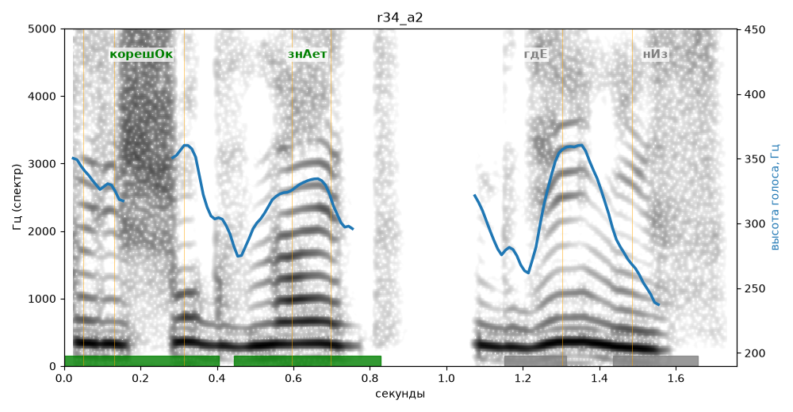

# r34_a2

Голос: **Mac Milena** · длительность 1.8 с
Естественность (UTMOS): **2.78 из 5** (живой диктор ≈ 4–4.5)
Эталон: Корешок знает, где низ.
Распознано: Кришук знает, где Нис.
Расхождения в словах: «корешок» → «кришук»; «низ» → «нис»

## Ударения
(где нужно: ruaccent)

| слово | нужно | у голоса | |
|---|---|---|---|
| корешок | корешОк | корешОк | ✓ |
| знает | знАет | знАет | ✓ |

## Интонация
- ✓ «корешок знает где низ.» — конец фразы понижается — звучит законченно
- Диапазон голоса 5.5 полутонов (нормально), средняя высота 317 Гц

## Паузы и темп
- паузы на своих местах
- Темп 5.2 слога/с (нормально)

_Синяя линия — высота голоса. Над словами заглавная буква — где ударение должно быть; красным — голос поставил не туда (уверенно), оранжевым — возможно._
