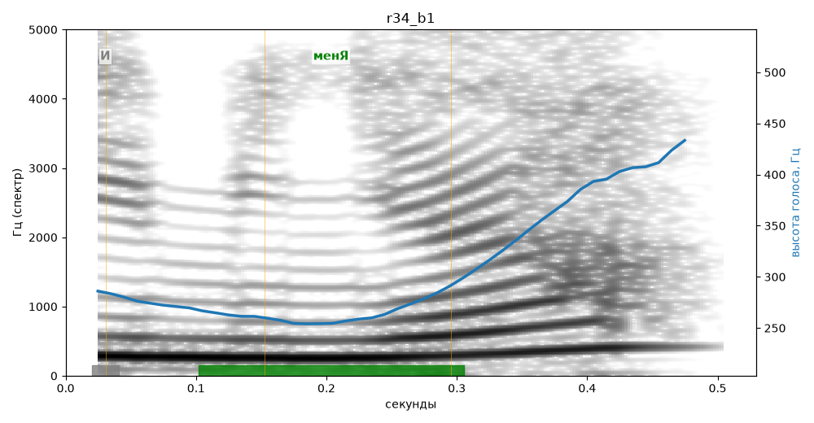

# r34_b1

Голос: **Mac Milena** · длительность 0.5 с
Естественность (UTMOS): **2.62 из 5** (живой диктор ≈ 4–4.5)
Эталон: И меня?
Распознано: И меня?
Слова: все совпали

## Ударения
(где нужно: ruaccent)

| слово | нужно | у голоса | |
|---|---|---|---|
| меня | менЯ | менЯ | ✓ |

## Интонация
- ✗ «и меня?» — нет вопросительного подъёма (самое высокое место — «меня», в начале) — звучит как утверждение
- Диапазон голоса 8.3 полутонов (живо), средняя высота 279 Гц

## Паузы и темп
- паузы на своих местах
- Темп 10.5 слога/с (быстро)

_Синяя линия — высота голоса. Над словами заглавная буква — где ударение должно быть; красным — голос поставил не туда (уверенно), оранжевым — возможно._
