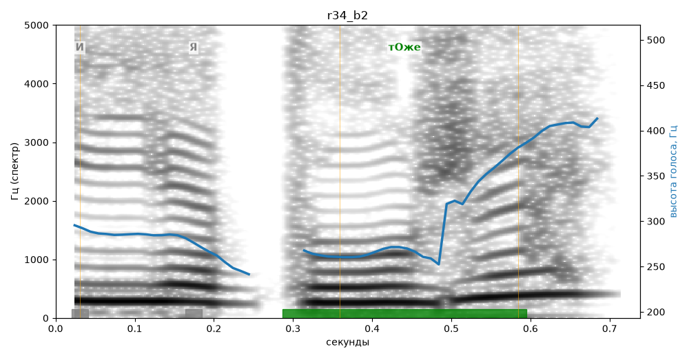

# r34_b2

Голос: **Mac Milena** · длительность 0.7 с
Естественность (UTMOS): **2.89 из 5** (живой диктор ≈ 4–4.5)
Эталон: И я тоже?
Распознано: Я тоже?
Расхождения в словах: «и» → «»

## Ударения
(где нужно: ruaccent)

| слово | нужно | у голоса | |
|---|---|---|---|
| тоже | тОже | тОже | ✓ |

## Интонация
- ✗ «и я тоже?» — нет вопросительного подъёма (самое высокое место — «и», в начале) — звучит как утверждение
- Диапазон голоса 8.3 полутонов (живо), средняя высота 285 Гц

## Паузы и темп
- паузы на своих местах
- Темп 5.2 слога/с (нормально)

_Синяя линия — высота голоса. Над словами заглавная буква — где ударение должно быть; красным — голос поставил не туда (уверенно), оранжевым — возможно._
