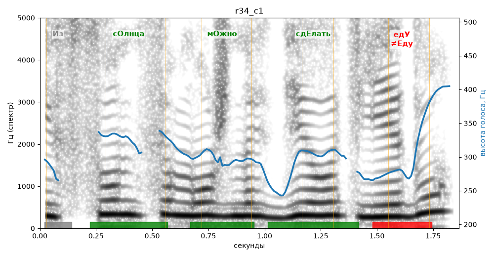

# r34_c1

Голос: **Mac Milena** · длительность 1.9 с
Естественность (UTMOS): **2.69 из 5** (живой диктор ≈ 4–4.5)
Эталон: Из солнца можно сделать еду?
Распознано: и солнце можно сделать еду?
Расхождения в словах: «из солнца» → «и солнце»

## Ударения
(где нужно: ruaccent)

| слово | нужно | у голоса | |
|---|---|---|---|
| солнца | сОлнца | сОлнца | ✓ |
| можно | мОжно | мОжно | ✓ |
| сделать | сдЕлать | сдЕлать | ✓ |
| еду | едУ | Еду | ✗ ОШИБКА |

## Интонация
- ✓ «из солнца можно сделать еду?» — вопросительный подъём на слове «еду»
- Диапазон голоса 7.1 полутонов (живо), средняя высота 301 Гц

## Паузы и темп
- паузы на своих местах
- Темп 5.2 слога/с (нормально)

_Синяя линия — высота голоса. Над словами заглавная буква — где ударение должно быть; красным — голос поставил не туда (уверенно), оранжевым — возможно._
