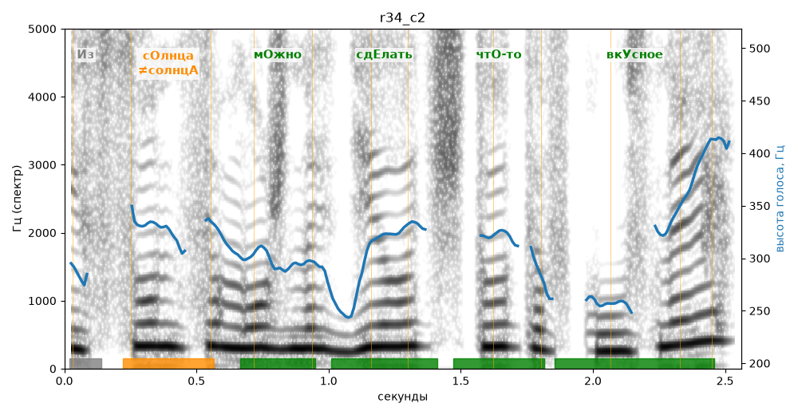

# r34_c2

Голос: **Mac Milena** · длительность 2.6 с
Естественность (UTMOS): **2.82 из 5** (живой диктор ≈ 4–4.5)
Эталон: Из солнца можно сделать что-то вкусное?
Распознано: из солнца можно сделать что-то вкусное?
Слова: все совпали

## Ударения
(где нужно: ruaccent)

| слово | нужно | у голоса | |
|---|---|---|---|
| солнца | сОлнца | солнцА | ✗? возможно — послушать |
| можно | мОжно | мОжно | ✓ |
| сделать | сдЕлать | сдЕлать | ✓ |
| что-то | чтО-то | чтО-то | ✓ |
| вкусное | вкУсное | вкУсное | ✓ |

## Интонация
- ✗ «из солнца можно сделать что-то вкусное?» — нет вопросительного подъёма (самое высокое место — «солнца», в начале) — звучит как утверждение
- Диапазон голоса 8.0 полутонов (живо), средняя высота 312 Гц

## Паузы и темп
- паузы на своих местах
- Темп 4.9 слога/с (нормально)

_Синяя линия — высота голоса. Над словами заглавная буква — где ударение должно быть; красным — голос поставил не туда (уверенно), оранжевым — возможно._
