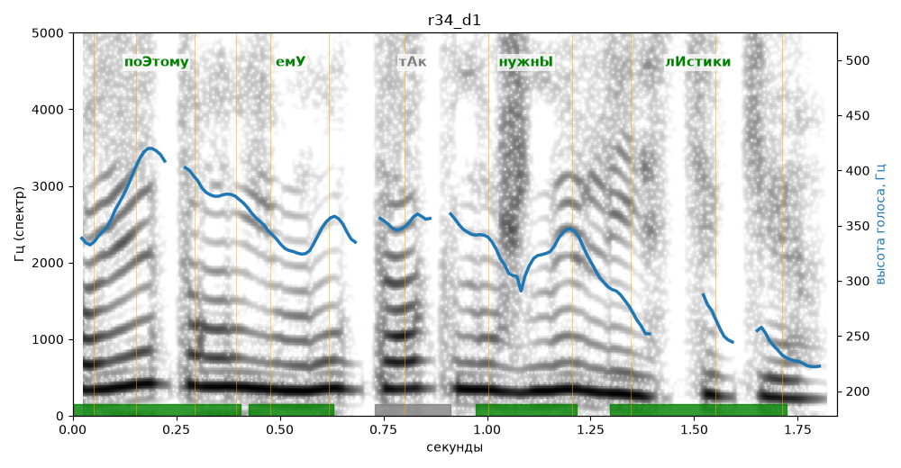

# r34_d1

Голос: **Mac Milena** · длительность 1.8 с
Естественность (UTMOS): **2.48 из 5** (живой диктор ≈ 4–4.5)
Эталон: Поэтому ему так нужны листики.
Распознано: Поэтому ему так нужны листики.
Слова: все совпали

## Ударения
(где нужно: ruaccent)

| слово | нужно | у голоса | |
|---|---|---|---|
| поэтому | поЭтому | поЭтому | ✓ |
| ему | емУ | емУ | ✓ |
| нужны | нужнЫ | нужнЫ | ✓ |
| листики | лИстики | лИстики | ✓ |

## Интонация
- ✓ «поэтому ему так нужны листики.» — конец фразы понижается — звучит законченно
- Диапазон голоса 9.8 полутонов (живо), средняя высота 340 Гц

## Паузы и темп
- паузы на своих местах
- Темп 7.0 слога/с (быстро)

_Синяя линия — высота голоса. Над словами заглавная буква — где ударение должно быть; красным — голос поставил не туда (уверенно), оранжевым — возможно._
