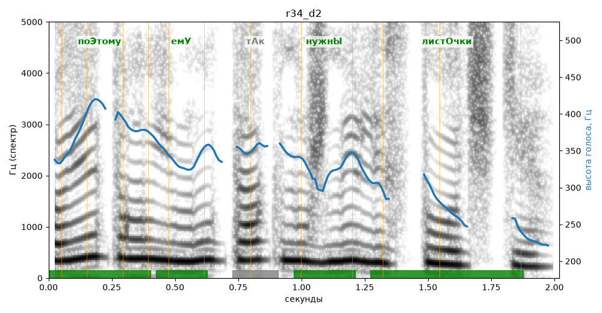

# r34_d2

Голос: **Mac Milena** · длительность 2.0 с
Естественность (UTMOS): **2.43 из 5** (живой диктор ≈ 4–4.5)
Эталон: Поэтому ему так нужны листочки.
Распознано: Поэтому ему так нужны листочки.
Слова: все совпали

## Ударения
(где нужно: ruaccent)

| слово | нужно | у голоса | |
|---|---|---|---|
| поэтому | поЭтому | поЭтому | ✓ |
| ему | емУ | емУ | ✓ |
| нужны | нужнЫ | нужнЫ | ✓ |
| листочки | листОчки | листОчки | ✓ |

## Интонация
- ✓ «поэтому ему так нужны листочки.» — конец фразы понижается — звучит законченно
- Диапазон голоса 9.7 полутонов (живо), средняя высота 338 Гц

## Паузы и темп
- паузы на своих местах
- Темп 6.4 слога/с (нормально)

_Синяя линия — высота голоса. Над словами заглавная буква — где ударение должно быть; красным — голос поставил не туда (уверенно), оранжевым — возможно._
