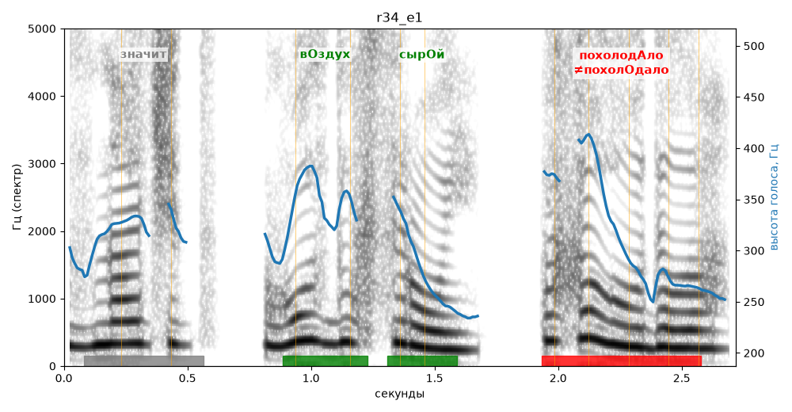

# r34_e1

Голос: **Mac Milena** · длительность 2.7 с
Естественность (UTMOS): **2.12 из 5** (живой диктор ≈ 4–4.5)
Эталон: Значит, воздух сырой. Похолодало.
Распознано: Значит, воздух срой похолодило.
Расхождения в словах: «сырой похолодало» → «срой похолодило»

## Ударения
(где нужно: ruaccent)

| слово | нужно | у голоса | |
|---|---|---|---|
| значит | значит | знАчит | нет эталона |
| воздух | вОздух | вОздух | ✓ |
| сырой | сырОй | сырОй | ✓ |
| похолодало | похолодАло | похолОдало | ✗ ОШИБКА |

## Интонация
- ✓ «значит воздух сырой.» — конец фразы понижается — звучит законченно
- ✓ «похолодало.» — конец фразы понижается — звучит законченно
- Диапазон голоса 8.0 полутонов (живо), средняя высота 309 Гц

## Паузы и темп
- паузы на своих местах
- Темп 6.0 слога/с (нормально)

_Синяя линия — высота голоса. Над словами заглавная буква — где ударение должно быть; красным — голос поставил не туда (уверенно), оранжевым — возможно._
