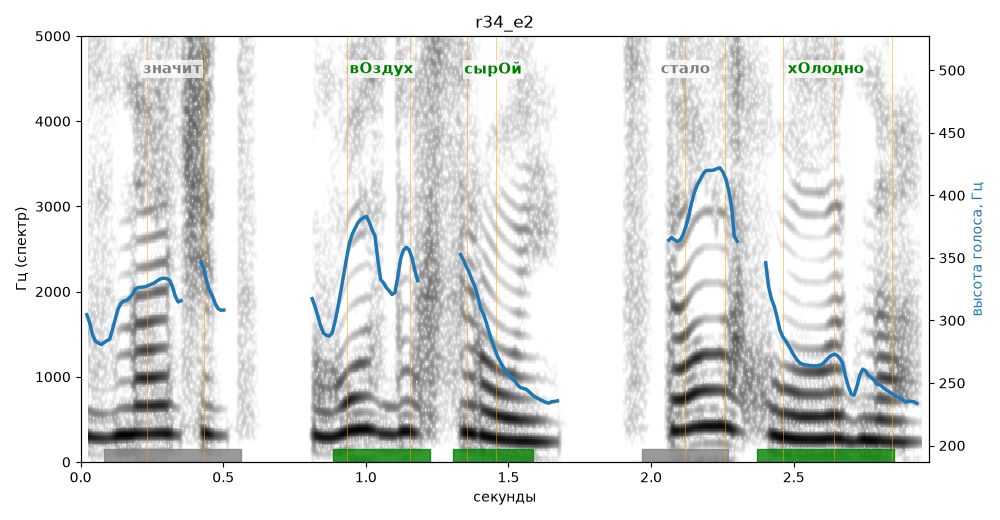

# r34_e2

Голос: **Mac Milena** · длительность 3.0 с
Естественность (UTMOS): **2.51 из 5** (живой диктор ≈ 4–4.5)
Эталон: Значит, воздух сырой. Стало холодно.
Распознано: Значит, воздух срой. Стал и холодно.
Расхождения в словах: «сырой стало» → «срой стал и»

## Ударения
(где нужно: ruaccent)

| слово | нужно | у голоса | |
|---|---|---|---|
| значит | значит | знАчит | нет эталона |
| воздух | вОздух | вОздух | ✓ |
| сырой | сырОй | сырОй | ✓ |
| стало | стало | стАло | нет эталона |
| холодно | хОлодно | хОлодно | ✓ |

## Интонация
- ✓ «значит воздух сырой.» — конец фразы понижается — звучит законченно
- ✗ «стало холодно.» — конец фразы не понижается — звучит незаконченно / как перечисление
- Диапазон голоса 9.6 полутонов (живо), средняя высота 309 Гц

## Паузы и темп
- паузы на своих местах
- Темп 5.3 слога/с (нормально)

_Синяя линия — высота голоса. Над словами заглавная буква — где ударение должно быть; красным — голос поставил не туда (уверенно), оранжевым — возможно._
