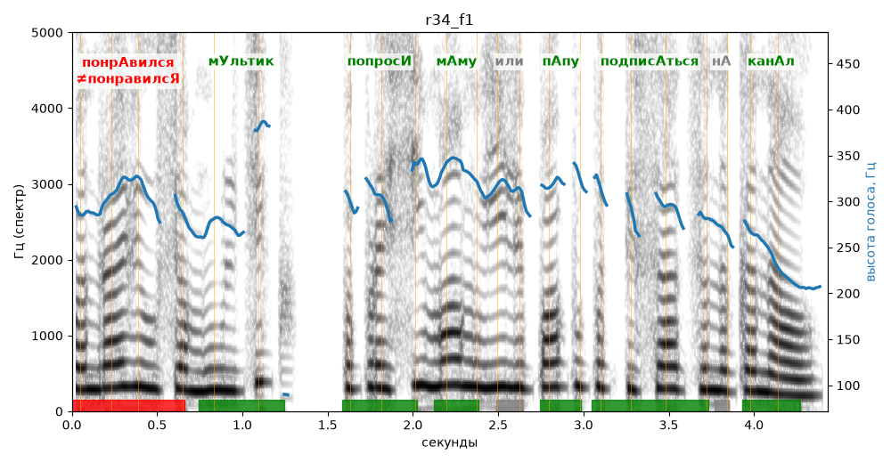

# r34_f1

Голос: **Mac Milena** · длительность 4.4 с
Естественность (UTMOS): **2.51 из 5** (живой диктор ≈ 4–4.5)
Эталон: Понравился мультик? Попроси маму или папу подписаться на канал.
Распознано: понравился мультик, попроси маму или папу подписаться на канал.
Слова: все совпали

## Ударения
(где нужно: ruaccent)

| слово | нужно | у голоса | |
|---|---|---|---|
| понравился | понрАвился | понравилсЯ | ✗ ОШИБКА |
| мультик | мУльтик | мУльтик | ✓ |
| попроси | попросИ | попросИ | ✓ |
| маму | мАму | мАму | ✓ |
| или | или | Или | нет эталона |
| папу | пАпу | пАпу | ✓ |
| подписаться | подписАться | подписАться | ✓ |
| канал | канАл | канАл | ✓ |

## Интонация
- ✗ «понравился мультик?» — нет вопросительного подъёма (самое высокое место — «понравился», в начале) — звучит как утверждение
- ✓ «попроси маму или папу подписаться на канал.» — конец фразы понижается — звучит законченно
- Диапазон голоса 8.8 полутонов (живо), средняя высота 297 Гц

## Паузы и темп
- паузы на своих местах
- Темп 5.6 слога/с (нормально)

_Синяя линия — высота голоса. Над словами заглавная буква — где ударение должно быть; красным — голос поставил не туда (уверенно), оранжевым — возможно._
