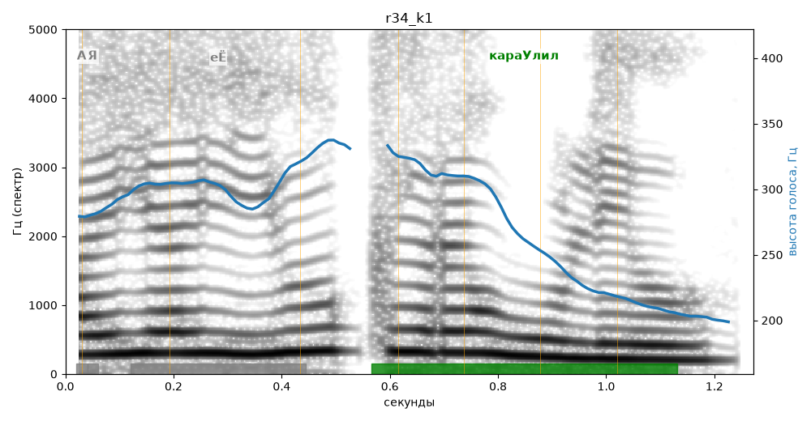

# r34_k1

Голос: **голос iPhone (Milena, Mac) — сам** · длительность 1.3 с
Естественность (UTMOS): **1.98 из 5** (живой диктор ≈ 4–4.5)
Эталон: А я её караулил!
Распознано: А я Юкера улил.
Расхождения в словах: «ее караулил» → «юкера улил»

## Ударения
(где нужно: ruaccent)

| слово | нужно | у голоса | |
|---|---|---|---|
| её | еЁ | Её | ? не разобрать |
| караулил | караУлил | караУлил | ✓ |

## Интонация
- ✗ «а я её караулил!» — восклицание звучит ровно, без эмоции
- Диапазон голоса 8.5 полутонов (живо), средняя высота 293 Гц

## Паузы и темп
- паузы на своих местах
- Темп 6.3 слога/с (нормально)

_Синяя линия — высота голоса. Над словами заглавная буква — где ударение должно быть; красным — голос поставил не туда (уверенно), оранжевым — возможно._
