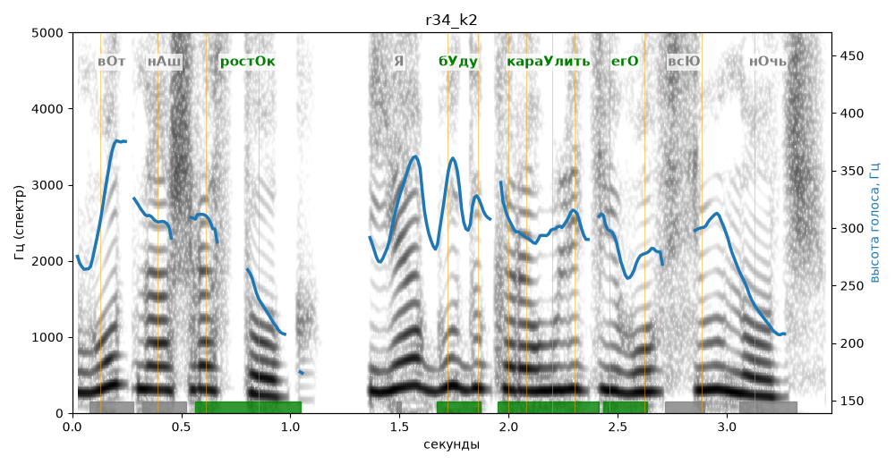

# r34_k2

Голос: **голос iPhone (Milena, Mac) — сам** · длительность 3.5 с
Естественность (UTMOS): **2.58 из 5** (живой диктор ≈ 4–4.5)
Эталон: Вот наш росток. Я буду караулить его всю ночь.
Распознано: Вот наш расток, я буду караулить его всю ночь.
Расхождения в словах: «росток» → «расток»

## Ударения
(где нужно: ruaccent)

| слово | нужно | у голоса | |
|---|---|---|---|
| росток | ростОк | ростОк | ✓ |
| буду | бУду | бУду | ✓ |
| караулить | караУлить | караУлить | ✓ |
| его | егО | егО | ✓ |

## Интонация
- ✓ «вот наш росток.» — конец фразы понижается — звучит законченно
- ✓ «я буду караулить его всю ночь.» — конец фразы понижается — звучит законченно
- Диапазон голоса 9.0 полутонов (живо), средняя высота 298 Гц

## Паузы и темп
- паузы на своих местах
- Темп 5.7 слога/с (нормально)

_Синяя линия — высота голоса. Над словами заглавная буква — где ударение должно быть; красным — голос поставил не туда (уверенно), оранжевым — возможно._
