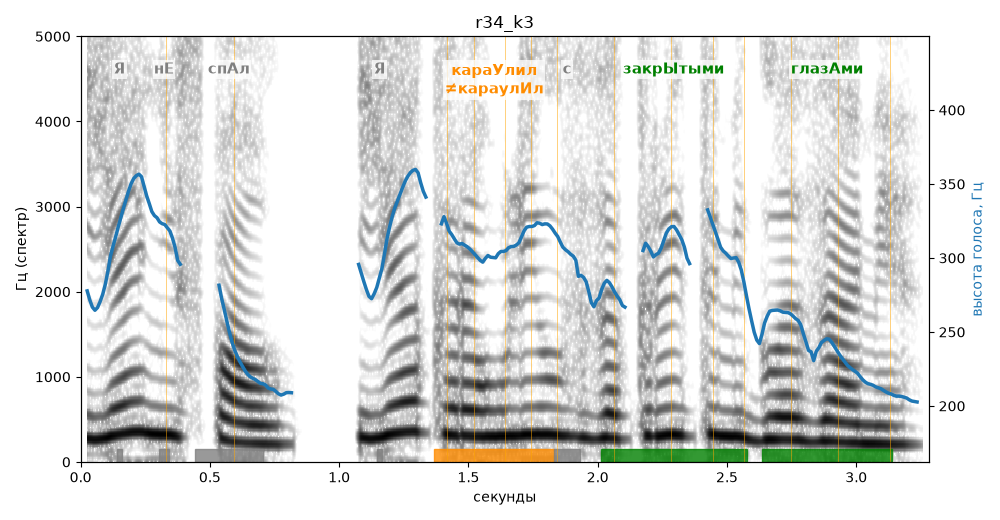

# r34_k3

Голос: **голос iPhone (Milena, Mac) — сам** · длительность 3.3 с
Естественность (UTMOS): **2.68 из 5** (живой диктор ≈ 4–4.5)
Эталон: Я не спал! Я караулил с закрытыми глазами!
Распознано: Я не спал, я караулился закрытыми глазами.
Расхождения в словах: «караулил с» → «караулился»

## Ударения
(где нужно: ruaccent)

| слово | нужно | у голоса | |
|---|---|---|---|
| караулил | караУлил | караулИл | ✗? возможно — послушать |
| закрытыми | закрЫтыми | закрЫтыми | ✓ |
| глазами | глазАми | глазАми | ✓ |

## Интонация
- ✗ «я караулил с закрытыми глазами!» — восклицание звучит ровно, без эмоции
- Диапазон голоса 8.8 полутонов (живо), средняя высота 291 Гц

## Паузы и темп
- паузы на своих местах
- Темп 5.9 слога/с (нормально)

_Синяя линия — высота голоса. Над словами заглавная буква — где ударение должно быть; красным — голос поставил не туда (уверенно), оранжевым — возможно._
