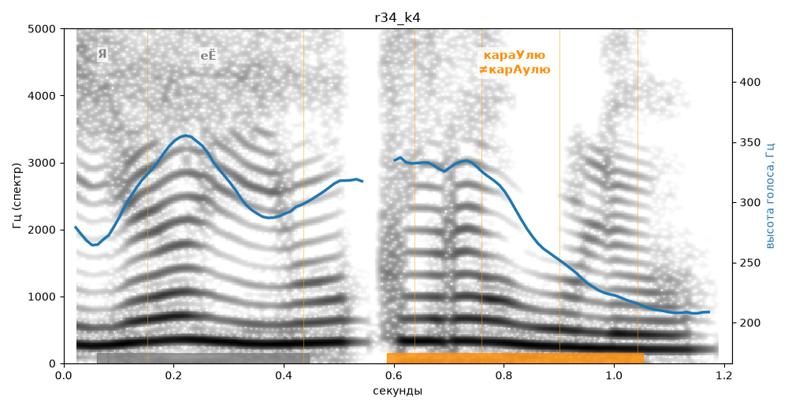

# r34_k4

Голос: **голос iPhone (Milena, Mac) — сам** · длительность 1.2 с
Естественность (UTMOS): **1.8 из 5** (живой диктор ≈ 4–4.5)
Эталон: Я её караулю.
Распознано: Я Юка Раулю.
Расхождения в словах: «ее караулю» → «юка раулю»

## Ударения
(где нужно: ruaccent)

| слово | нужно | у голоса | |
|---|---|---|---|
| её | еЁ | Её | ? не разобрать |
| караулю | караУлю | карАулю | ✗? возможно — послушать |

## Интонация
- ✓ «я её караулю.» — конец фразы понижается — звучит законченно
- Диапазон голоса 8.8 полутонов (живо), средняя высота 297 Гц

## Паузы и темп
- паузы на своих местах
- Темп 6.1 слога/с (нормально)

_Синяя линия — высота голоса. Над словами заглавная буква — где ударение должно быть; красным — голос поставил не туда (уверенно), оранжевым — возможно._
