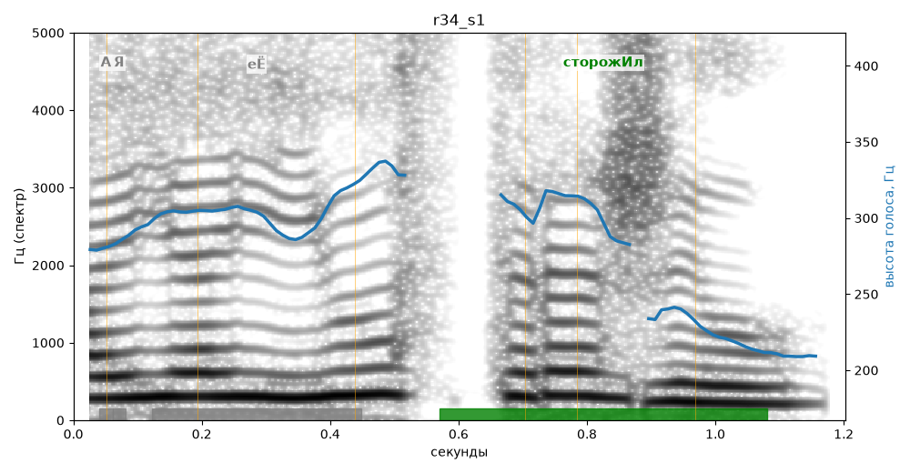

# r34_s1

Голос: **голос iPhone (Milena, Mac) — сам** · длительность 1.2 с
Естественность (UTMOS): **2.53 из 5** (живой диктор ≈ 4–4.5)
Эталон: А я её сторожил!
Распознано: А я ее строжил.
Расхождения в словах: «сторожил» → «строжил»

## Ударения
(где нужно: ruaccent)

| слово | нужно | у голоса | |
|---|---|---|---|
| её | еЁ | Её | ? не разобрать |
| сторожил | сторожИл | сторожИл | ✓ |

## Интонация
- ✗ «а я её сторожил!» — восклицание звучит ровно, без эмоции
- Диапазон голоса 7.8 полутонов (живо), средняя высота 297 Гц

## Паузы и темп
- паузы на своих местах
- Темп 5.8 слога/с (нормально)

_Синяя линия — высота голоса. Над словами заглавная буква — где ударение должно быть; красным — голос поставил не туда (уверенно), оранжевым — возможно._
