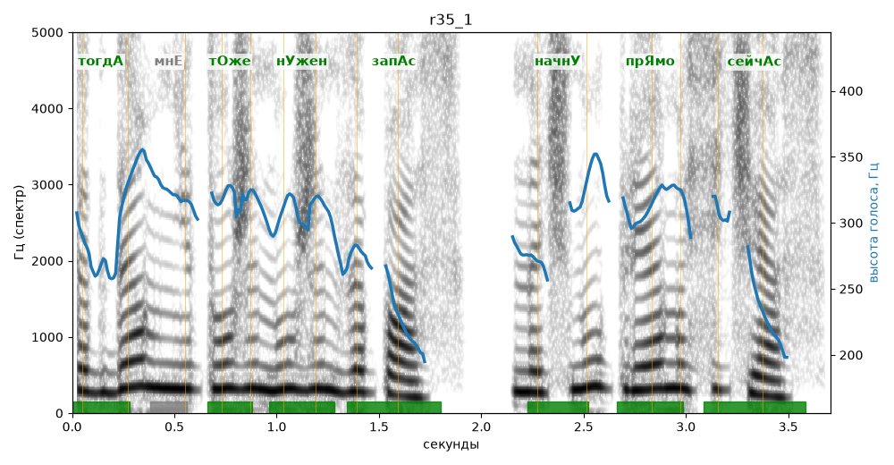

# r35_1

Голос: **Mac Milena** · длительность 3.7 с
Естественность (UTMOS): **3.0 из 5** (живой диктор ≈ 4–4.5)
Эталон: Тогда мне тоже нужен запас. Начну прямо сейчас.
Распознано: Тогда мне тоже нужен запас. Начну прямо сейчас.
Слова: все совпали

## Ударения
(где нужно: ruaccent)

| слово | нужно | у голоса | |
|---|---|---|---|
| тогда | тогдА | тогдА | ✓ |
| тоже | тОже | тОже | ✓ |
| нужен | нУжен | нУжен | ✓ |
| запас | запАс | запАс | ✓ |
| начну | начнУ | начнУ | ✓ |
| прямо | прЯмо | прЯмо | ✓ |
| сейчас | сейчАс | сейчАс | ✓ |

## Интонация
- ✓ «тогда мне тоже нужен запас.» — конец фразы понижается — звучит законченно
- ✓ «начну прямо сейчас.» — конец фразы понижается — звучит законченно
- Диапазон голоса 8.2 полутонов (живо), средняя высота 305 Гц

## Паузы и темп
- паузы на своих местах
- Темп 4.7 слога/с (нормально)

_Синяя линия — высота голоса. Над словами заглавная буква — где ударение должно быть; красным — голос поставил не туда (уверенно), оранжевым — возможно._
