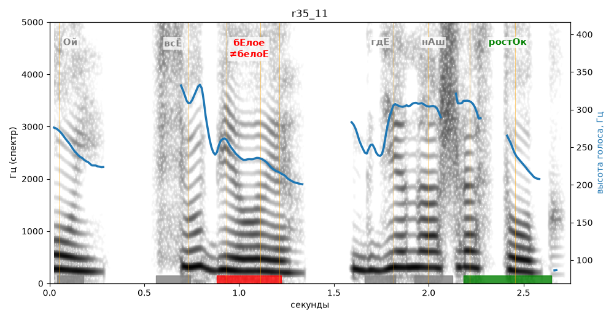

# r35_11

Голос: **Mac Milena** · длительность 2.7 с
Естественность (UTMOS): **2.73 из 5** (живой диктор ≈ 4–4.5)
Эталон: Ой! Всё белое! Где наш росток?
Распознано: Ой, все белое, где наш расток?
Расхождения в словах: «росток» → «расток»

## Ударения
(где нужно: ruaccent)

| слово | нужно | у голоса | |
|---|---|---|---|
| белое | бЕлое | белоЕ | ✗ ОШИБКА |
| росток | ростОк | ростОк | ✓ |

## Интонация
- ✓ «всё белое!» — выделено слово «всё» (+4.8 пт)
- ✓ «где наш росток?» — конец фразы понижается — звучит законченно
- Диапазон голоса 7.3 полутонов (живо), средняя высота 251 Гц

## Паузы и темп
- паузы на своих местах
- Темп 5.0 слога/с (нормально)

_Синяя линия — высота голоса. Над словами заглавная буква — где ударение должно быть; красным — голос поставил не туда (уверенно), оранжевым — возможно._
