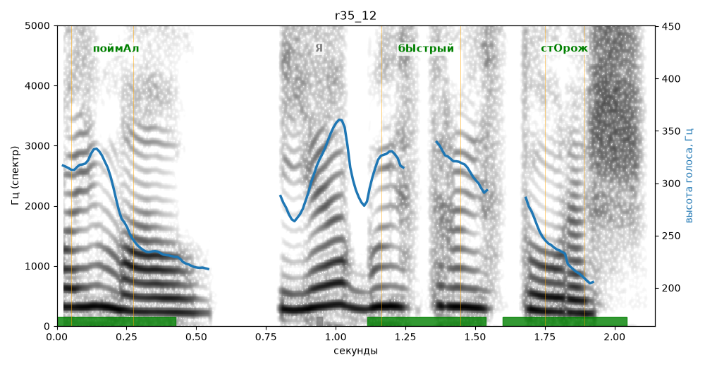

# r35_12

Голос: **Mac Milena** · длительность 2.1 с
Естественность (UTMOS): **3.03 из 5** (живой диктор ≈ 4–4.5)
Эталон: Поймал! Я быстрый сторож!
Распознано: поймал, я быстро историшь.
Расхождения в словах: «быстрый сторож» → «быстро историшь»

## Ударения
(где нужно: ruaccent)

| слово | нужно | у голоса | |
|---|---|---|---|
| поймал | поймАл | поймАл | ✓ |
| быстрый | бЫстрый | бЫстрый | ✓ |
| сторож | стОрож | стОрож | ✓ |

## Интонация
- ✓ «я быстрый сторож!» — выделено слово «быстрый» (+2.1 пт)
- Диапазон голоса 7.7 полутонов (живо), средняя высота 286 Гц

## Паузы и темп
- паузы на своих местах
- Темп 4.4 слога/с (нормально)

_Синяя линия — высота голоса. Над словами заглавная буква — где ударение должно быть; красным — голос поставил не туда (уверенно), оранжевым — возможно._
