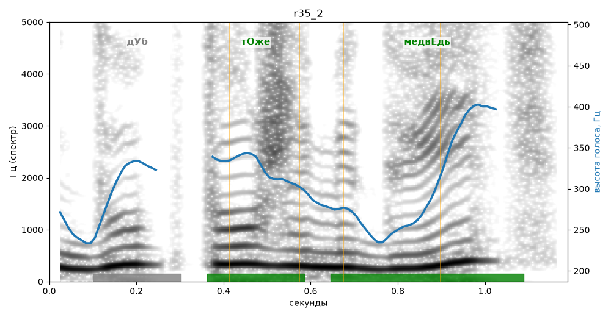

# r35_2

Голос: **Mac Milena** · длительность 1.2 с
Естественность (UTMOS): **2.46 из 5** (живой диктор ≈ 4–4.5)
Эталон: Дуб тоже медведь?
Распознано: Дуб тоже медведь?
Слова: все совпали

## Ударения
(где нужно: ruaccent)

| слово | нужно | у голоса | |
|---|---|---|---|
| тоже | тОже | тОже | ✓ |
| медведь | медвЕдь | медвЕдь | ✓ |

## Интонация
- ✗ «дуб тоже медведь?» — нет вопросительного подъёма (самое высокое место — «тоже», в начале) — звучит как утверждение
- Диапазон голоса 8.9 полутонов (живо), средняя высота 302 Гц

## Паузы и темп
- паузы на своих местах
- Темп 5.1 слога/с (нормально)

_Синяя линия — высота голоса. Над словами заглавная буква — где ударение должно быть; красным — голос поставил не туда (уверенно), оранжевым — возможно._
