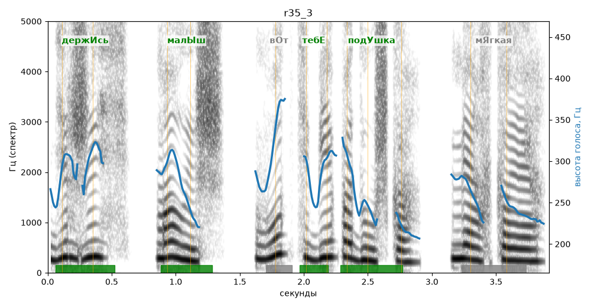

# r35_3

Голос: **Mac Milena** · длительность 3.9 с
Естественность (UTMOS): **2.68 из 5** (живой диктор ≈ 4–4.5)
Эталон: Держись, малыш! Вот тебе подушка. Мягкая!
Распознано: Держись, малыш, вот тебе подушка, мягкая.
Слова: все совпали

## Ударения
(где нужно: ruaccent)

| слово | нужно | у голоса | |
|---|---|---|---|
| держись | держИсь | держИсь | ✓ |
| малыш | малЫш | малЫш | ✓ |
| тебе | тебЕ | тебЕ | ✓ |
| подушка | подУшка | подУшка | ✓ |
| мягкая | мЯгкая | — | ? |

## Интонация
- ✗ «держись малыш!» — восклицание звучит ровно, без эмоции
- ✓ «вот тебе подушка.» — конец фразы понижается — звучит законченно
- Диапазон голоса 6.9 полутонов (нормально), средняя высота 267 Гц

## Паузы и темп
- паузы на своих местах
- Темп 4.9 слога/с (нормально)

_Синяя линия — высота голоса. Над словами заглавная буква — где ударение должно быть; красным — голос поставил не туда (уверенно), оранжевым — возможно._
