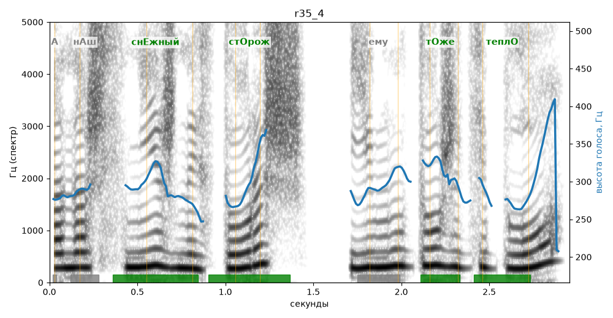

# r35_4

Голос: **Mac Milena** · длительность 3.0 с
Естественность (UTMOS): **2.73 из 5** (живой диктор ≈ 4–4.5)
Эталон: А наш снежный сторож? Ему тоже тепло?
Распознано: А наш снежный сторож ему тоже тепло?
Слова: все совпали

## Ударения
(где нужно: ruaccent)

| слово | нужно | у голоса | |
|---|---|---|---|
| снежный | снЕжный | снЕжный | ✓ |
| сторож | стОрож | стОрож | ✓ |
| ему | ему | емУ | нет эталона |
| тоже | тОже | тОже | ✓ |
| тепло | теплО | теплО | ✓ |

## Интонация
- ✗ «а наш снежный сторож?» — нет вопросительного подъёма (самое высокое место — «снежный», в начале) — звучит как утверждение
- ✗ «ему тоже тепло?» — нет вопросительного подъёма (самое высокое место — «тоже», в начале) — звучит как утверждение
- Диапазон голоса 5.4 полутонов (нормально), средняя высота 290 Гц

## Паузы и темп
- паузы на своих местах
- Темп 5.1 слога/с (нормально)

_Синяя линия — высота голоса. Над словами заглавная буква — где ударение должно быть; красным — голос поставил не туда (уверенно), оранжевым — возможно._
