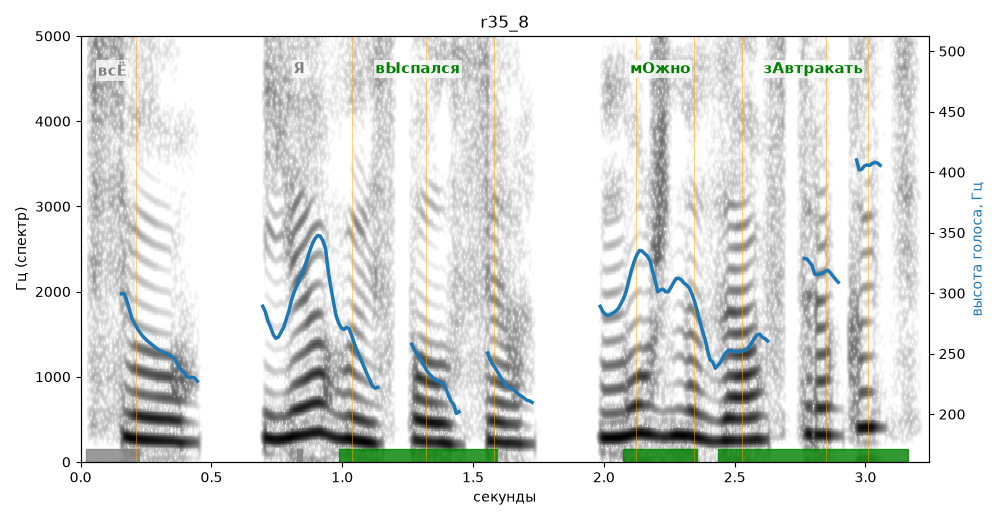

# r35_8

Голос: **Mac Milena** · длительность 3.2 с
Естественность (UTMOS): **2.82 из 5** (живой диктор ≈ 4–4.5)
Эталон: Всё! Я выспался! Можно завтракать?
Распознано: Всё, я выспался, можно завтракать?
Слова: все совпали

## Ударения
(где нужно: ruaccent)

| слово | нужно | у голоса | |
|---|---|---|---|
| выспался | вЫспался | вЫспался | ✓ |
| можно | мОжно | мОжно | ✓ |
| завтракать | зАвтракать | зАвтракать | ✓ |

## Интонация
- ✓ «я выспался!» — выделено слово «выспался» (+2.7 пт)
- ✗ «можно завтракать?» — нет вопросительного подъёма (самое высокое место — «можно», в начале) — звучит как утверждение
- Диапазон голоса 8.2 полутонов (живо), средняя высота 269 Гц

## Паузы и темп
- паузы на своих местах
- Темп 4.4 слога/с (нормально)

_Синяя линия — высота голоса. Над словами заглавная буква — где ударение должно быть; красным — голос поставил не туда (уверенно), оранжевым — возможно._
