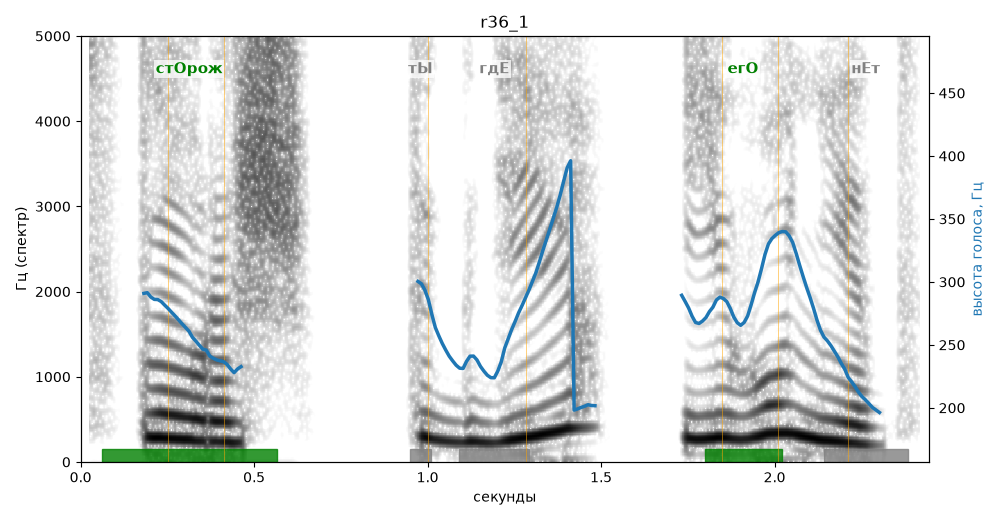

# r36_1

Голос: **Mac Milena** · длительность 2.4 с
Естественность (UTMOS): **2.47 из 5** (живой диктор ≈ 4–4.5)
Эталон: Сторож! Ты где? Его нет!
Распознано: Стой, Рож, ты где? Его нет.
Расхождения в словах: «сторож» → «стой рож»

## Ударения
(где нужно: ruaccent)

| слово | нужно | у голоса | |
|---|---|---|---|
| сторож | стОрож | стОрож | ✓ |
| его | егО | егО | ✓ |

## Интонация
- ✓ «его нет!» — выделено слово «его» (+2.8 пт)
- Диапазон голоса 9.1 полутонов (живо), средняя высота 268 Гц

## Паузы и темп
- паузы на своих местах
- Темп 4.9 слога/с (нормально)

_Синяя линия — высота голоса. Над словами заглавная буква — где ударение должно быть; красным — голос поставил не туда (уверенно), оранжевым — возможно._
