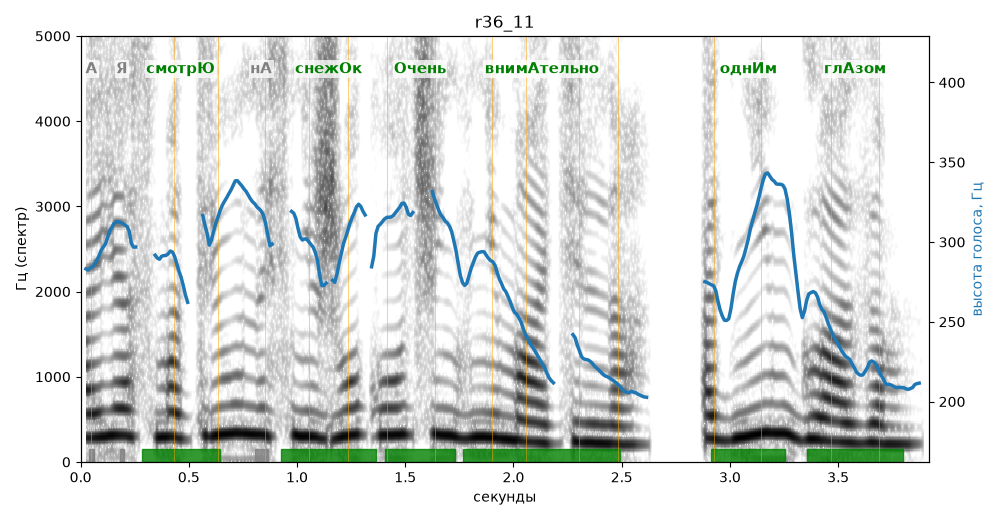

# r36_11

Голос: **Mac Milena** · длительность 3.9 с
Естественность (UTMOS): **2.99 из 5** (живой диктор ≈ 4–4.5)
Эталон: А я смотрю на снежок очень внимательно. Одним глазом.
Распознано: А я смотрю на снежок очень внимательно, одним глазом.
Слова: все совпали

## Ударения
(где нужно: ruaccent)

| слово | нужно | у голоса | |
|---|---|---|---|
| смотрю | смотрЮ | смотрЮ | ✓ |
| снежок | снежОк | снежОк | ✓ |
| очень | Очень | Очень | ✓ |
| внимательно | внимАтельно | внимАтельно | ✓ |
| одним | однИм | однИм | ✓ |
| глазом | глАзом | глАзом | ✓ |

## Интонация
- ✓ «а я смотрю на снежок очень внимательно.» — конец фразы понижается — звучит законченно
- ✓ «одним глазом.» — конец фразы понижается — звучит законченно
- Диапазон голоса 8.1 полутонов (живо), средняя высота 285 Гц

## Паузы и темп
- паузы на своих местах
- Темп 5.0 слога/с (нормально)

_Синяя линия — высота голоса. Над словами заглавная буква — где ударение должно быть; красным — голос поставил не туда (уверенно), оранжевым — возможно._
