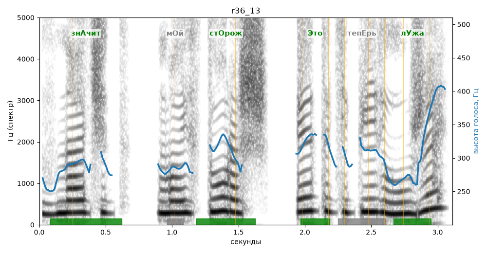

# r36_13

Голос: **Mac Milena** · длительность 3.1 с
Естественность (UTMOS): **2.41 из 5** (живой диктор ≈ 4–4.5)
Эталон: Значит, мой сторож — это теперь лужа?
Распознано: Значит, маисторож, это теперь лужа?
Расхождения в словах: «мой сторож» → «маисторож»

## Ударения
(где нужно: ruaccent)

| слово | нужно | у голоса | |
|---|---|---|---|
| значит | знАчит | знАчит | ✓ |
| сторож | стОрож | стОрож | ✓ |
| это | Это | Это | ✓ |
| теперь | тепЕрь | — | ? |
| лужа | лУжа | лУжа | ✓ |

## Интонация
- ✗ «значит мой сторож это теперь лужа?» — нет вопросительного подъёма (самое высокое место — «это», в начале) — звучит как утверждение
- Диапазон голоса 6.7 полутонов (нормально), средняя высота 293 Гц

## Паузы и темп
- паузы на своих местах
- Темп 5.5 слога/с (нормально)

_Синяя линия — высота голоса. Над словами заглавная буква — где ударение должно быть; красным — голос поставил не туда (уверенно), оранжевым — возможно._
