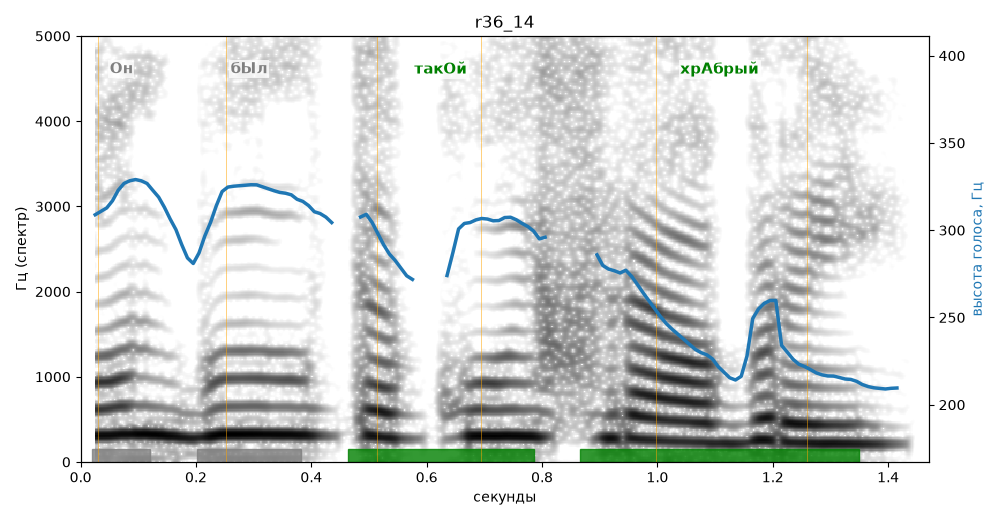

# r36_14

Голос: **Mac Milena** · длительность 1.5 с
Естественность (UTMOS): **2.33 из 5** (живой диктор ≈ 4–4.5)
Эталон: Он был такой храбрый.
Распознано: Он был такой храбрый.
Слова: все совпали

## Ударения
(где нужно: ruaccent)

| слово | нужно | у голоса | |
|---|---|---|---|
| такой | такОй | такОй | ✓ |
| храбрый | хрАбрый | хрАбрый | ✓ |

## Интонация
- ✓ «он был такой храбрый.» — конец фразы понижается — звучит законченно
- Диапазон голоса 7.5 полутонов (живо), средняя высота 287 Гц

## Паузы и темп
- паузы на своих местах
- Темп 4.5 слога/с (нормально)

_Синяя линия — высота голоса. Над словами заглавная буква — где ударение должно быть; красным — голос поставил не туда (уверенно), оранжевым — возможно._
