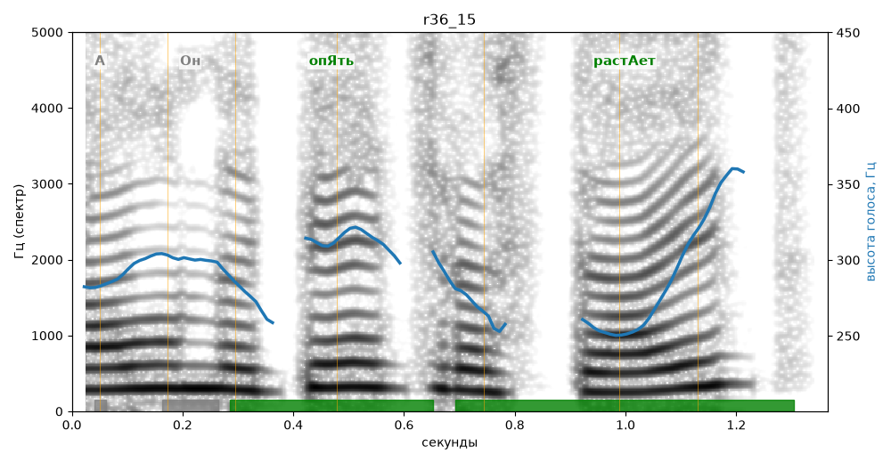

# r36_15

Голос: **Mac Milena** · длительность 1.4 с
Естественность (UTMOS): **2.53 из 5** (живой диктор ≈ 4–4.5)
Эталон: А он опять растает?
Распознано: А он опять растает?
Слова: все совпали

## Ударения
(где нужно: ruaccent)

| слово | нужно | у голоса | |
|---|---|---|---|
| опять | опЯть | опЯть | ✓ |
| растает | растАет | растАет | ✓ |

## Интонация
- ✗ «а он опять растает?» — нет вопросительного подъёма (самое высокое место — «опять», в начале) — звучит как утверждение
- Диапазон голоса 5.4 полутонов (нормально), средняя высота 294 Гц

## Паузы и темп
- паузы на своих местах
- Темп 5.5 слога/с (нормально)

_Синяя линия — высота голоса. Над словами заглавная буква — где ударение должно быть; красным — голос поставил не туда (уверенно), оранжевым — возможно._
