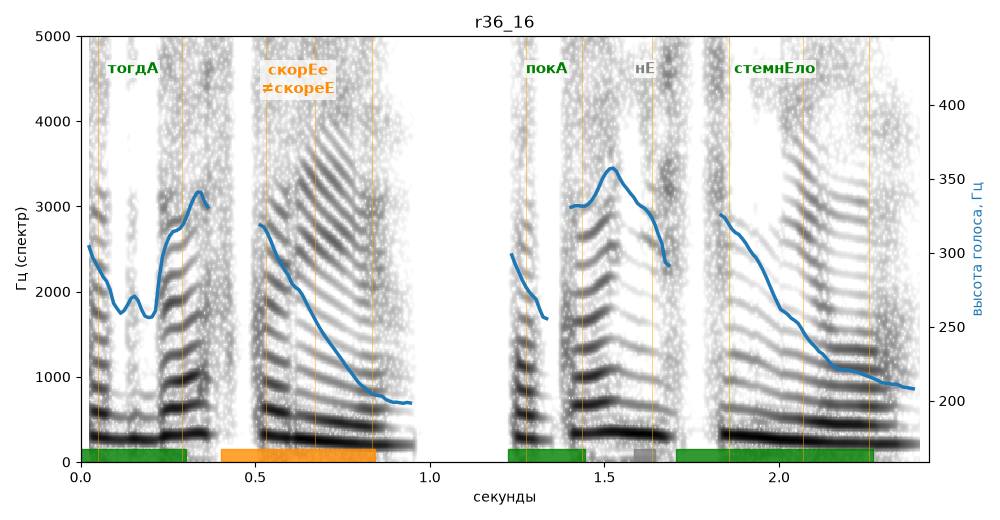

# r36_16

Голос: **Mac Milena** · длительность 2.4 с
Естественность (UTMOS): **3.13 из 5** (живой диктор ≈ 4–4.5)
Эталон: Тогда скорее! Пока не стемнело!
Распознано: Тогда скорее, пока не стемнило.
Расхождения в словах: «стемнело» → «стемнило»

## Ударения
(где нужно: ruaccent)

| слово | нужно | у голоса | |
|---|---|---|---|
| тогда | тогдА | тогдА | ✓ |
| скорее | скорЕе | скореЕ | ✗? возможно — послушать |
| пока | покА | покА | ✓ |
| стемнело | стемнЕло | стемнЕло | ✓ |

## Интонация
- ✓ «тогда скорее!» — выделено слово «тогда» (+2.6 пт)
- ✓ «пока не стемнело!» — выделено слово «пока» (+2.6 пт)
- Диапазон голоса 9.0 полутонов (живо), средняя высота 271 Гц

## Паузы и темп
- паузы на своих местах
- Темп 5.8 слога/с (нормально)

_Синяя линия — высота голоса. Над словами заглавная буква — где ударение должно быть; красным — голос поставил не туда (уверенно), оранжевым — возможно._
