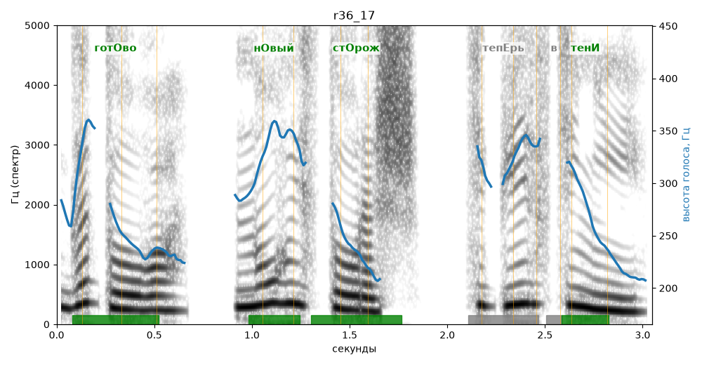

# r36_17

Голос: **Mac Milena** · длительность 3.0 с
Естественность (UTMOS): **2.93 из 5** (живой диктор ≈ 4–4.5)
Эталон: Готово! Новый сторож! Теперь в тени.
Распознано: Готово! Новый сторож! Теперь в тени!
Слова: все совпали

## Ударения
(где нужно: ruaccent)

| слово | нужно | у голоса | |
|---|---|---|---|
| готово | готОво | готОво | ✓ |
| новый | нОвый | нОвый | ✓ |
| сторож | стОрож | стОрож | ✓ |
| теперь | тепЕрь | — | ? |
| тени | тенИ | тенИ | ✓ |

## Интонация
- ✗ «готово!» — восклицание звучит ровно, без эмоции
- ✗ «новый сторож!» — восклицание звучит ровно, без эмоции
- ✓ «теперь в тени.» — конец фразы понижается — звучит законченно
- Диапазон голоса 8.9 полутонов (живо), средняя высота 273 Гц

## Паузы и темп
- паузы на своих местах
- Темп 6.7 слога/с (быстро)

_Синяя линия — высота голоса. Над словами заглавная буква — где ударение должно быть; красным — голос поставил не туда (уверенно), оранжевым — возможно._
