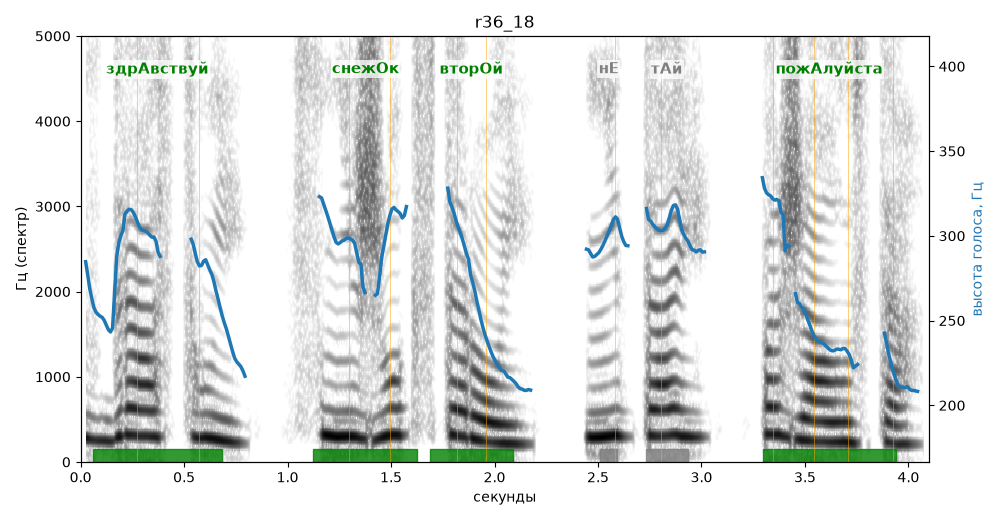

# r36_18

Голос: **Mac Milena** · длительность 4.1 с
Естественность (UTMOS): **2.61 из 5** (живой диктор ≈ 4–4.5)
Эталон: Здравствуй, Снежок Второй. Не тай, пожалуйста.
Распознано: Здравствуй, снижок второй, не тай, пожалуйста.
Расхождения в словах: «снежок» → «снижок»

## Ударения
(где нужно: ruaccent)

| слово | нужно | у голоса | |
|---|---|---|---|
| здравствуй | здрАвствуй | здрАвствуй | ✓ |
| снежок | снежОк | снежОк | ✓ |
| второй | вторОй | вторОй | ✓ |
| пожалуйста | пожАлуйста | пожАлуйста | ✓ |

## Интонация
- ✓ «здравствуй снежок второй.» — конец фразы понижается — звучит законченно
- ✓ «не тай пожалуйста.» — конец фразы понижается — звучит законченно
- Диапазон голоса 7.2 полутонов (живо), средняя высота 288 Гц

## Паузы и темп
- паузы на своих местах
- Темп 4.5 слога/с (нормально)

_Синяя линия — высота голоса. Над словами заглавная буква — где ударение должно быть; красным — голос поставил не туда (уверенно), оранжевым — возможно._
