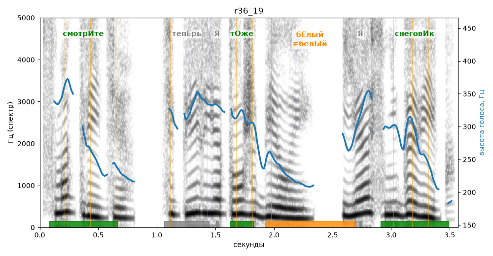

# r36_19

Голос: **Mac Milena** · длительность 3.6 с
Естественность (UTMOS): **2.69 из 5** (живой диктор ≈ 4–4.5)
Эталон: Смотрите! Теперь я тоже белый! Я снеговик!
Распознано: Смотрите, теперь я тоже белый, я снеговик.
Слова: все совпали

## Ударения
(где нужно: ruaccent)

| слово | нужно | у голоса | |
|---|---|---|---|
| смотрите | смотрИте | смотрИте | ✓ |
| теперь | тепЕрь | — | ? |
| тоже | тОже | тОже | ✓ |
| белый | бЕлый | белЫй | ✗? возможно — послушать |
| снеговик | снеговИк | снеговИк | ✓ |

## Интонация
- ✗ «смотрите!» — восклицание звучит ровно, без эмоции
- ✗ «теперь я тоже белый!» — восклицание звучит ровно, без эмоции
- ✗ «я снеговик!» — восклицание звучит ровно, без эмоции
- Диапазон голоса 8.9 полутонов (живо), средняя высота 285 Гц

## Паузы и темп
- после «белый!» пауза всего 0.04 с — фразы слипаются
- Темп 4.6 слога/с (нормально)

_Синяя линия — высота голоса. Над словами заглавная буква — где ударение должно быть; красным — голос поставил не туда (уверенно), оранжевым — возможно._
