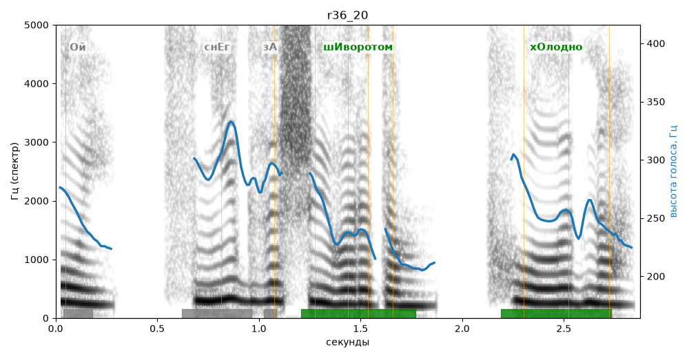

# r36_20

Голос: **Mac Milena** · длительность 2.9 с
Естественность (UTMOS): **2.84 из 5** (живой диктор ≈ 4–4.5)
Эталон: Ой. Снег за шиворотом. Холодно!
Распознано: Ой, снег за шиворотом, холодно.
Слова: все совпали

## Ударения
(где нужно: ruaccent)

| слово | нужно | у голоса | |
|---|---|---|---|
| шиворотом | шИворотом | шИворотом | ✓ |
| холодно | хОлодно | хОлодно | ✓ |

## Интонация
- ✗ «снег за шиворотом.» — конец фразы не понижается — звучит незаконченно / как перечисление
- ✗ «холодно!» — восклицание звучит ровно, без эмоции
- Диапазон голоса 6.6 полутонов (нормально), средняя высота 249 Гц

## Паузы и темп
- паузы на своих местах
- Темп 5.5 слога/с (нормально)

_Синяя линия — высота голоса. Над словами заглавная буква — где ударение должно быть; красным — голос поставил не туда (уверенно), оранжевым — возможно._
