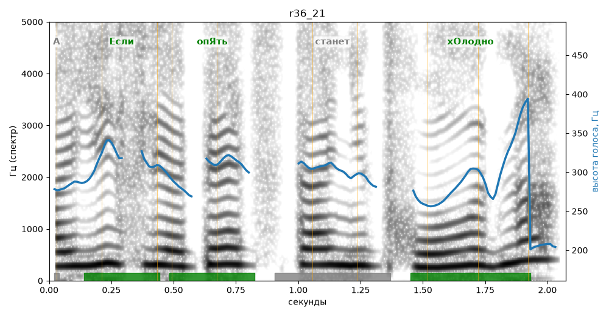

# r36_21

Голос: **Mac Milena** · длительность 2.1 с
Естественность (UTMOS): **2.64 из 5** (живой диктор ≈ 4–4.5)
Эталон: А если опять станет холодно?
Распознано: А если опять станет холодно?
Слова: все совпали

## Ударения
(где нужно: ruaccent)

| слово | нужно | у голоса | |
|---|---|---|---|
| если | Если | Если | ✓ |
| опять | опЯть | опЯть | ✓ |
| станет | станет | стАнет | нет эталона |
| холодно | хОлодно | хОлодно | ✓ |

## Интонация
- ✗ «а если опять станет холодно?» — нет вопросительного подъёма (самое высокое место — «если», в начале) — звучит как утверждение
- Диапазон голоса 8.6 полутонов (живо), средняя высота 298 Гц

## Паузы и темп
- паузы на своих местах
- Темп 5.2 слога/с (нормально)

_Синяя линия — высота голоса. Над словами заглавная буква — где ударение должно быть; красным — голос поставил не туда (уверенно), оранжевым — возможно._
