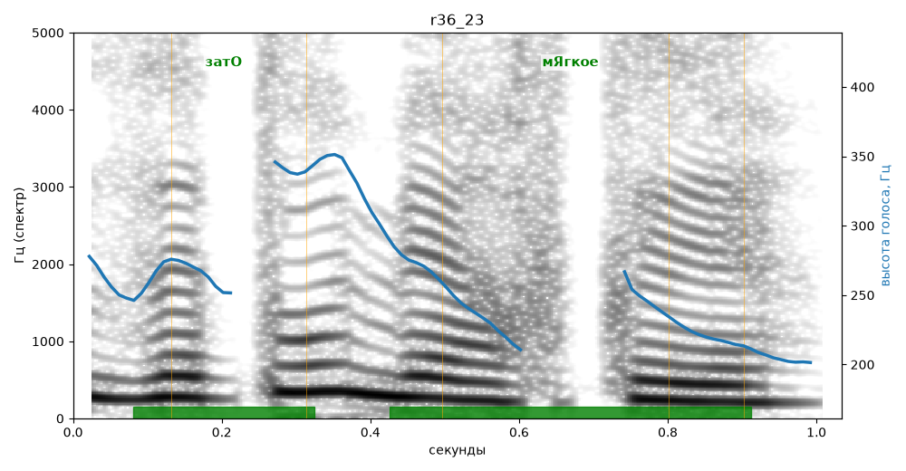

# r36_23

Голос: **Mac Milena** · длительность 1.0 с
Естественность (UTMOS): **2.05 из 5** (живой диктор ≈ 4–4.5)
Эталон: Зато мягкое.
Распознано: Зато мягкие.
Расхождения в словах: «мягкое» → «мягкие»

## Ударения
(где нужно: ruaccent)

| слово | нужно | у голоса | |
|---|---|---|---|
| зато | затО | затО | ✓ |
| мягкое | мЯгкое | мЯгкое | ✓ |

## Интонация
- ✗ «зато мягкое.» — конец фразы не понижается — звучит незаконченно / как перечисление
- Диапазон голоса 9.2 полутонов (живо), средняя высота 253 Гц

## Паузы и темп
- паузы на своих местах
- Темп 6.0 слога/с (нормально)

_Синяя линия — высота голоса. Над словами заглавная буква — где ударение должно быть; красным — голос поставил не туда (уверенно), оранжевым — возможно._
