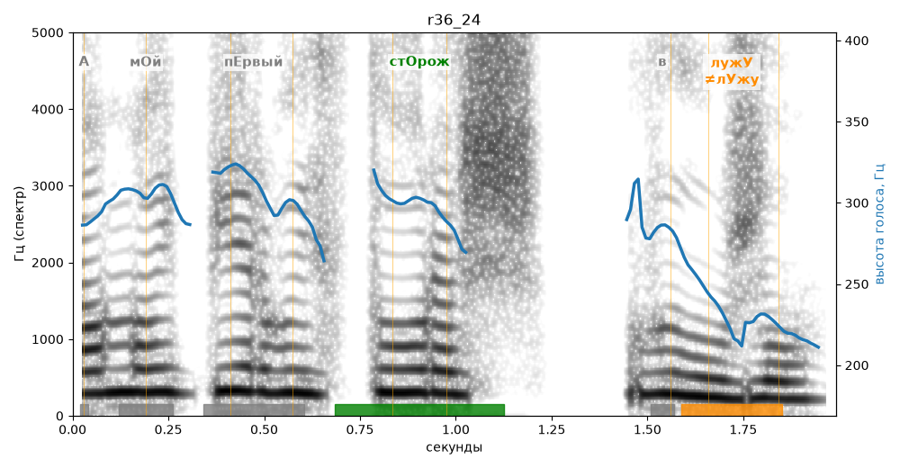

# r36_24

Голос: **Mac Milena** · длительность 2.0 с
Естественность (UTMOS): **2.65 из 5** (живой диктор ≈ 4–4.5)
Эталон: А мой первый сторож — в лужу.
Распознано: А мой первый сторож – в лужу.
Слова: все совпали

## Ударения
(где нужно: ruaccent)

| слово | нужно | у голоса | |
|---|---|---|---|
| первый | пЕрвый | первЫй | ? не разобрать |
| сторож | стОрож | стОрож | ✓ |
| лужу | лужУ | лУжу | ✗? возможно — послушать |

## Интонация
- ✓ «а мой первый сторож в лужу.» — конец фразы понижается — звучит законченно
- Диапазон голоса 6.8 полутонов (нормально), средняя высота 292 Гц

## Паузы и темп
- паузы на своих местах
- Темп 6.2 слога/с (нормально)

_Синяя линия — высота голоса. Над словами заглавная буква — где ударение должно быть; красным — голос поставил не туда (уверенно), оранжевым — возможно._
