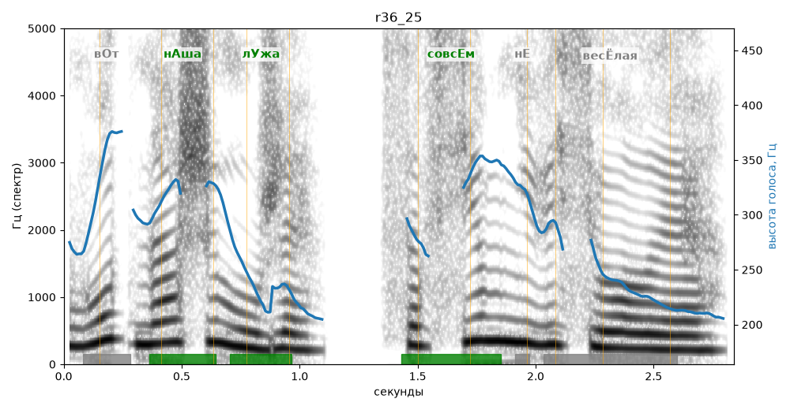

# r36_25

Голос: **Mac Milena** · длительность 2.8 с
Естественность (UTMOS): **2.61 из 5** (живой диктор ≈ 4–4.5)
Эталон: Вот наша лужа. Совсем не весёлая.
Распознано: Вот наши лужи. Совсем не веселые.
Расхождения в словах: «наша лужа» → «наши лужи»; «веселая» → «веселые»

## Ударения
(где нужно: ruaccent)

| слово | нужно | у голоса | |
|---|---|---|---|
| наша | нАша | нАша | ✓ |
| лужа | лУжа | лУжа | ✓ |
| совсем | совсЕм | совсЕм | ✓ |
| весёлая | весЁлая | — | ? |

## Интонация
- ✓ «вот наша лужа.» — конец фразы понижается — звучит законченно
- ✓ «совсем не весёлая.» — конец фразы понижается — звучит законченно
- Диапазон голоса 9.0 полутонов (живо), средняя высота 269 Гц

## Паузы и темп
- паузы на своих местах
- Темп 5.4 слога/с (нормально)

_Синяя линия — высота голоса. Над словами заглавная буква — где ударение должно быть; красным — голос поставил не туда (уверенно), оранжевым — возможно._
