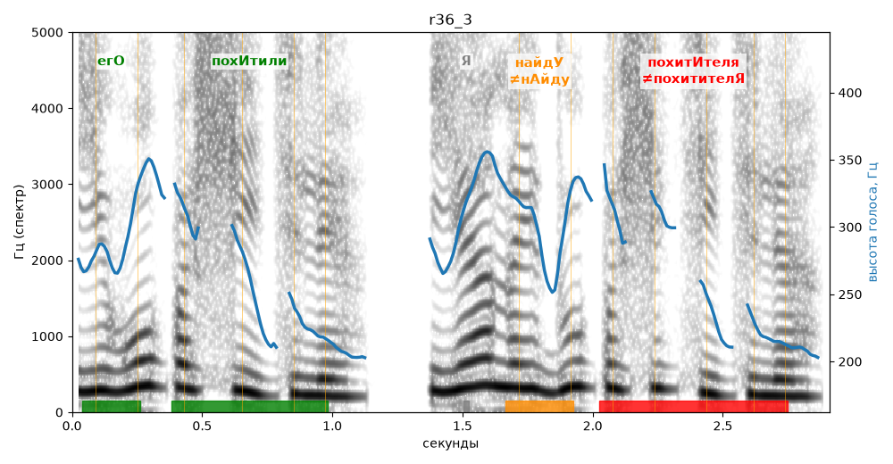

# r36_3

Голос: **Mac Milena** · длительность 2.9 с
Естественность (UTMOS): **2.99 из 5** (живой диктор ≈ 4–4.5)
Эталон: Его похитили! Я найду похитителя!
Распознано: Его посчители. Я найду посчителя.
Расхождения в словах: «похитили» → «посчители»; «похитителя» → «посчителя»

## Ударения
(где нужно: ruaccent)

| слово | нужно | у голоса | |
|---|---|---|---|
| его | егО | егО | ✓ |
| похитили | похИтили | похИтили | ✓ |
| найду | найдУ | нАйду | ✗? возможно — послушать |
| похитителя | похитИтеля | похитителЯ | ✗ ОШИБКА |

## Интонация
- ✓ «его похитили!» — выделено слово «его» (+3.5 пт)
- ✗ «я найду похитителя!» — восклицание звучит ровно, без эмоции
- Диапазон голоса 8.9 полутонов (живо), средняя высота 276 Гц

## Паузы и темп
- паузы на своих местах
- Темп 5.9 слога/с (нормально)

_Синяя линия — высота голоса. Над словами заглавная буква — где ударение должно быть; красным — голос поставил не туда (уверенно), оранжевым — возможно._
