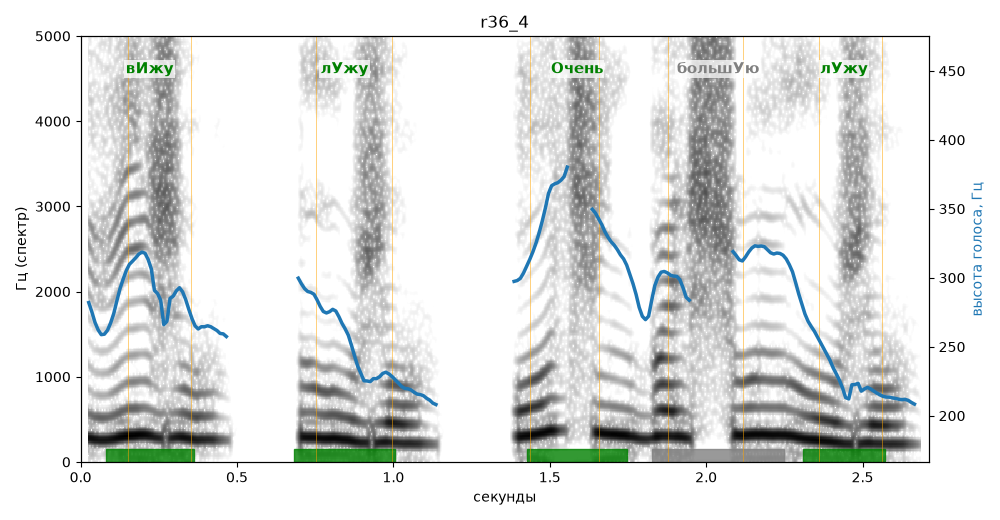

# r36_4

Голос: **Mac Milena** · длительность 2.7 с
Естественность (UTMOS): **2.34 из 5** (живой диктор ≈ 4–4.5)
Эталон: Вижу… лужу. Очень большую лужу.
Распознано: вижу, лужа, очень большую лужу.
Расхождения в словах: «лужу» → «лужа»

## Ударения
(где нужно: ruaccent)

| слово | нужно | у голоса | |
|---|---|---|---|
| вижу | вИжу | вИжу | ✓ |
| лужу | лУжу | лУжу | ✓ |
| очень | Очень | Очень | ✓ |
| большую | большУю | — | ? |
| лужу | лУжу | лУжу | ✓ |

## Интонация
- ✓ «очень большую лужу.» — конец фразы понижается — звучит законченно
- Диапазон голоса 8.3 полутонов (живо), средняя высота 278 Гц

## Паузы и темп
- паузы на своих местах
- Темп 5.7 слога/с (нормально)

_Синяя линия — высота голоса. Над словами заглавная буква — где ударение должно быть; красным — голос поставил не туда (уверенно), оранжевым — возможно._
