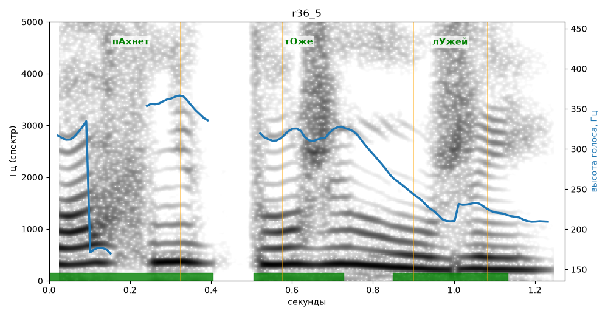

# r36_5

Голос: **Mac Milena** · длительность 1.3 с
Естественность (UTMOS): **2.47 из 5** (живой диктор ≈ 4–4.5)
Эталон: Пахнет… тоже лужей.
Распознано: пахнет тоже лужей.
Слова: все совпали

## Ударения
(где нужно: ruaccent)

| слово | нужно | у голоса | |
|---|---|---|---|
| пахнет | пАхнет | пАхнет | ✓ |
| тоже | тОже | тОже | ✓ |
| лужей | лУжей | лУжей | ✓ |

## Интонация
- ✓ «тоже лужей.» — конец фразы понижается — звучит законченно
- Диапазон голоса 12.2 полутонов (живо), средняя высота 301 Гц

## Паузы и темп
- после «пахнет…» пауза всего 0.10 с — фразы слипаются
- Темп 5.3 слога/с (нормально)

_Синяя линия — высота голоса. Над словами заглавная буква — где ударение должно быть; красным — голос поставил не туда (уверенно), оранжевым — возможно._
