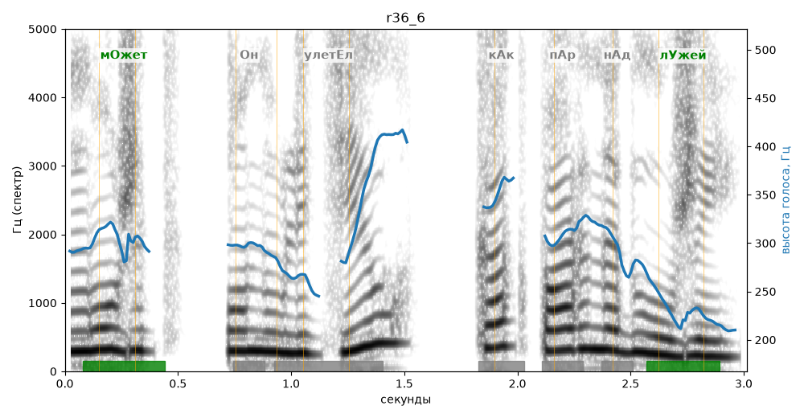

# r36_6

Голос: **Mac Milena** · длительность 3.0 с
Естественность (UTMOS): **2.88 из 5** (живой диктор ≈ 4–4.5)
Эталон: Может, он улетел? Как пар над лужей?
Распознано: Может, он улетел как парнодлужий?
Расхождения в словах: «пар над лужей» → «парнодлужий»

## Ударения
(где нужно: ruaccent)

| слово | нужно | у голоса | |
|---|---|---|---|
| может | мОжет | мОжет | ✓ |
| улетел | улетЕл | Улетел | ? не разобрать |
| лужей | лУжей | лУжей | ✓ |

## Интонация
- ✗ «может он улетел?» — нет вопросительного подъёма (самое высокое место — «улетел», в начале) — звучит как утверждение
- ✓ «как пар над лужей?» — конец фразы понижается — звучит законченно
- Диапазон голоса 11.1 полутонов (живо), средняя высота 297 Гц

## Паузы и темп
- паузы на своих местах
- Темп 5.3 слога/с (нормально)

_Синяя линия — высота голоса. Над словами заглавная буква — где ударение должно быть; красным — голос поставил не туда (уверенно), оранжевым — возможно._
