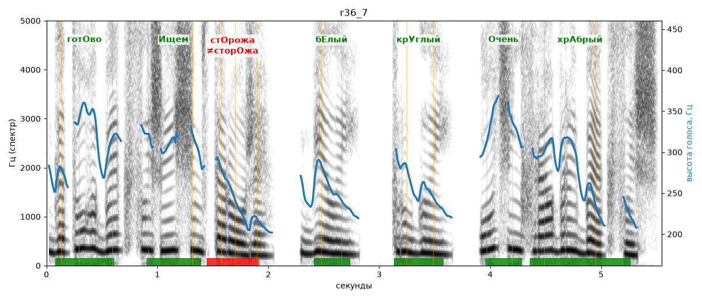

# r36_7

Голос: **Mac Milena** · длительность 5.5 с
Естественность (UTMOS): **2.59 из 5** (живой диктор ≈ 4–4.5)
Эталон: Готово! «Ищем сторожа. Белый. Круглый. Очень храбрый».
Распознано: Готовы бэкслыша ищем стороже. Белый, круглый, очень храбрый бэкслыш.
Расхождения в словах: «готово» → «готовы бэкслыша»; «сторожа» → «стороже»; «» → «бэкслыш»

## Ударения
(где нужно: ruaccent)

| слово | нужно | у голоса | |
|---|---|---|---|
| готово | готОво | готОво | ✓ |
| ищем | Ищем | Ищем | ✓ |
| сторожа | стОрожа | сторОжа | ✗ ОШИБКА |
| белый | бЕлый | бЕлый | ✓ |
| круглый | крУглый | крУглый | ✓ |
| очень | Очень | Очень | ✓ |
| храбрый | хрАбрый | хрАбрый | ✓ |

## Интонация
- ✗ «готово!» — восклицание звучит ровно, без эмоции
- ✗ «ищем сторожа.» — конец фразы не понижается — звучит незаконченно / как перечисление
- ✓ «очень храбрый.» — конец фразы понижается — звучит законченно
- Диапазон голоса 8.5 полутонов (живо), средняя высота 276 Гц

## Паузы и темп
- паузы на своих местах
- Темп 4.4 слога/с (нормально)

_Синяя линия — высота голоса. Над словами заглавная буква — где ударение должно быть; красным — голос поставил не туда (уверенно), оранжевым — возможно._
