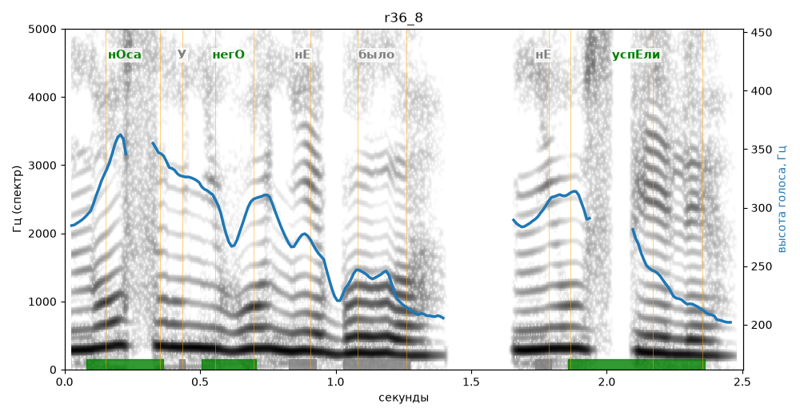

# r36_8

Голос: **Mac Milena** · длительность 2.5 с
Естественность (UTMOS): **2.82 из 5** (живой диктор ≈ 4–4.5)
Эталон: Носа у него не было. Не успели.
Распознано: носы у него не было, не успели.
Расхождения в словах: «носа» → «носы»

## Ударения
(где нужно: ruaccent)

| слово | нужно | у голоса | |
|---|---|---|---|
| носа | нОса | нОса | ✓ |
| него | негО | негО | ✓ |
| было | было | бЫло | нет эталона |
| успели | успЕли | успЕли | ✓ |

## Интонация
- ✓ «носа у него не было.» — конец фразы понижается — звучит законченно
- ✓ «не успели.» — конец фразы понижается — звучит законченно
- Диапазон голоса 8.8 полутонов (живо), средняя высота 277 Гц

## Паузы и темп
- паузы на своих местах
- Темп 6.6 слога/с (быстро)

_Синяя линия — высота голоса. Над словами заглавная буква — где ударение должно быть; красным — голос поставил не туда (уверенно), оранжевым — возможно._
