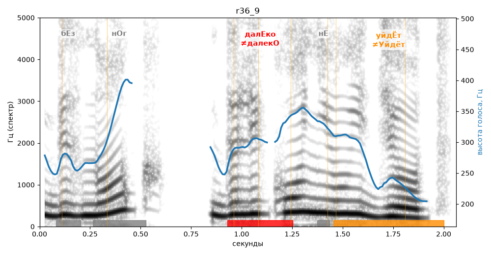

# r36_9

Голос: **Mac Milena** · длительность 2.1 с
Естественность (UTMOS): **2.64 из 5** (живой диктор ≈ 4–4.5)
Эталон: Без ног? Далеко не уйдёт.
Распознано: Без ног далеко не уйдет.
Слова: все совпали

## Ударения
(где нужно: ruaccent)

| слово | нужно | у голоса | |
|---|---|---|---|
| далеко | далЕко | далекО | ✗ ОШИБКА |
| уйдёт | уйдЁт | Уйдёт | ✗? возможно — послушать |

## Интонация
- ✓ «далеко не уйдёт.» — конец фразы понижается — звучит законченно
- Диапазон голоса 9.0 полутонов (живо), средняя высота 290 Гц

## Паузы и темп
- паузы на своих местах
- Темп 5.3 слога/с (нормально)

_Синяя линия — высота голоса. Над словами заглавная буква — где ударение должно быть; красным — голос поставил не туда (уверенно), оранжевым — возможно._
