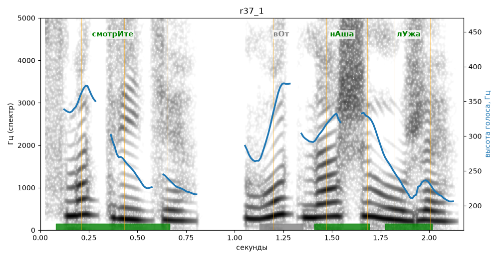

# r37_1

Голос: **Mac Milena** · длительность 2.2 с
Естественность (UTMOS): **2.78 из 5** (живой диктор ≈ 4–4.5)
Эталон: Смотрите! Вот наша лужа!
Распознано: Смотрите, вот наши лужи.
Расхождения в словах: «наша лужа» → «наши лужи»

## Ударения
(где нужно: ruaccent)

| слово | нужно | у голоса | |
|---|---|---|---|
| смотрите | смотрИте | смотрИте | ✓ |
| наша | нАша | нАша | ✓ |
| лужа | лУжа | лУжа | ✓ |

## Интонация
- ✗ «смотрите!» — восклицание звучит ровно, без эмоции
- ✗ «вот наша лужа!» — восклицание звучит ровно, без эмоции
- Диапазон голоса 9.6 полутонов (живо), средняя высота 269 Гц

## Паузы и темп
- паузы на своих местах
- Темп 5.4 слога/с (нормально)

_Синяя линия — высота голоса. Над словами заглавная буква — где ударение должно быть; красным — голос поставил не туда (уверенно), оранжевым — возможно._
