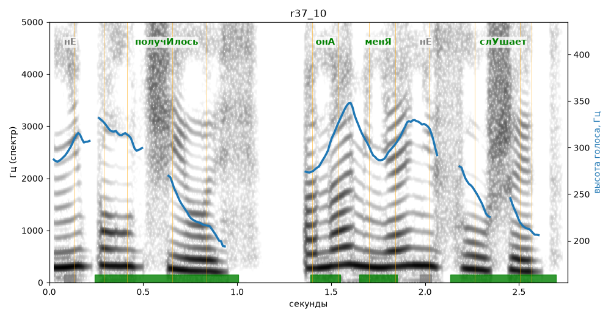

# r37_10

Голос: **Mac Milena** · длительность 2.8 с
Естественность (UTMOS): **3.5 из 5** (живой диктор ≈ 4–4.5)
Эталон: Не получилось. Она меня не слушает.
Распознано: не получилось, она меня не слушает.
Слова: все совпали

## Ударения
(где нужно: ruaccent)

| слово | нужно | у голоса | |
|---|---|---|---|
| получилось | получИлось | получИлось | ✓ |
| она | онА | онА | ✓ |
| меня | менЯ | менЯ | ✓ |
| слушает | слУшает | слУшает | ✓ |

## Интонация
- ✓ «не получилось.» — конец фразы понижается — звучит законченно
- ✓ «она меня не слушает.» — конец фразы понижается — звучит законченно
- Диапазон голоса 8.0 полутонов (живо), средняя высота 292 Гц

## Паузы и темп
- паузы на своих местах
- Темп 5.8 слога/с (нормально)

_Синяя линия — высота голоса. Над словами заглавная буква — где ударение должно быть; красным — голос поставил не туда (уверенно), оранжевым — возможно._
