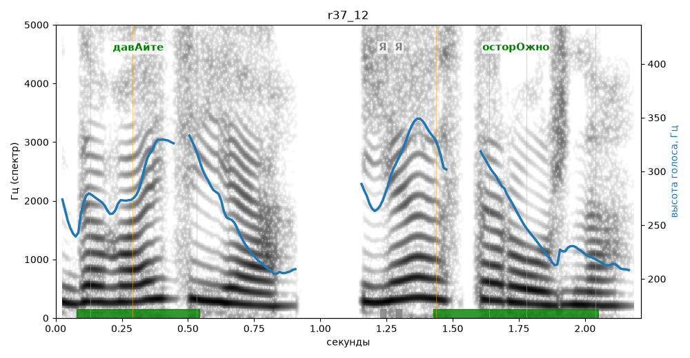

# r37_12

Голос: **Mac Milena** · длительность 2.2 с
Естественность (UTMOS): **3.09 из 5** (живой диктор ≈ 4–4.5)
Эталон: Давайте я! Я осторожно!
Распознано: Давайте я. Я осторожно.
Слова: все совпали

## Ударения
(где нужно: ruaccent)

| слово | нужно | у голоса | |
|---|---|---|---|
| давайте | давАйте | давАйте | ✓ |
| осторожно | осторОжно | осторОжно | ✓ |

## Интонация
- ✗ «давайте я!» — восклицание звучит ровно, без эмоции
- ✗ «я осторожно!» — восклицание звучит ровно, без эмоции
- Диапазон голоса 8.2 полутонов (живо), средняя высота 268 Гц

## Паузы и темп
- лишняя пауза 0.68 с между «давайте» и «я»
- после «я!» пауза всего 0.04 с — фразы слипаются
- Темп 5.4 слога/с (нормально)

_Синяя линия — высота голоса. Над словами заглавная буква — где ударение должно быть; красным — голос поставил не туда (уверенно), оранжевым — возможно._
