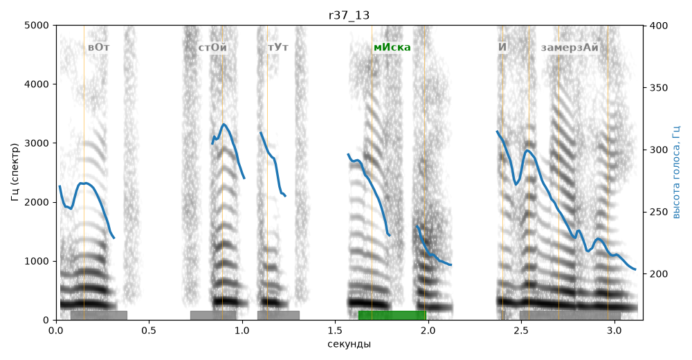

# r37_13

Голос: **Mac Milena** · длительность 3.2 с
Естественность (UTMOS): **2.59 из 5** (живой диктор ≈ 4–4.5)
Эталон: Вот. Стой тут, миска. И замерзай.
Распознано: Вот, стой тут, миска, из-за мерзой.
Расхождения в словах: «и замерзай» → «из-за мерзой»

## Ударения
(где нужно: ruaccent)

| слово | нужно | у голоса | |
|---|---|---|---|
| миска | мИска | мИска | ✓ |
| замерзай | замерзАй | зАмерзай | ? не разобрать |

## Интонация
- ✓ «стой тут миска.» — конец фразы понижается — звучит законченно
- ✓ «и замерзай.» — конец фразы понижается — звучит законченно
- Диапазон голоса 6.9 полутонов (нормально), средняя высота 263 Гц

## Паузы и темп
- паузы на своих местах
- Темп 4.8 слога/с (нормально)

_Синяя линия — высота голоса. Над словами заглавная буква — где ударение должно быть; красным — голос поставил не туда (уверенно), оранжевым — возможно._
