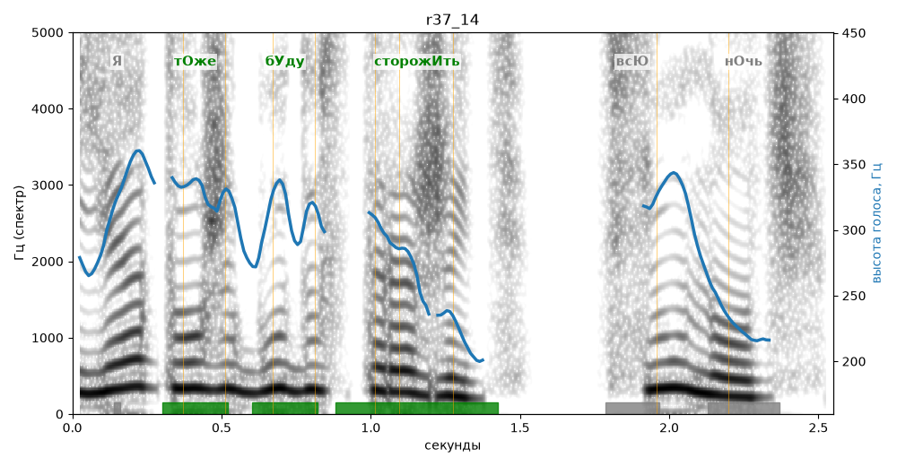

# r37_14

Голос: **Mac Milena** · длительность 2.5 с
Естественность (UTMOS): **2.83 из 5** (живой диктор ≈ 4–4.5)
Эталон: Я тоже буду сторожить. Всю ночь!
Распознано: Я тоже буду строжить, всю ночь.
Расхождения в словах: «сторожить» → «строжить»

## Ударения
(где нужно: ruaccent)

| слово | нужно | у голоса | |
|---|---|---|---|
| тоже | тОже | тОже | ✓ |
| буду | бУду | бУду | ✓ |
| сторожить | сторожИть | сторожИть | ✓ |

## Интонация
- ✓ «я тоже буду сторожить.» — конец фразы понижается — звучит законченно
- Диапазон голоса 8.1 полутонов (живо), средняя высота 299 Гц

## Паузы и темп
- паузы на своих местах
- Темп 5.3 слога/с (нормально)

_Синяя линия — высота голоса. Над словами заглавная буква — где ударение должно быть; красным — голос поставил не туда (уверенно), оранжевым — возможно._
