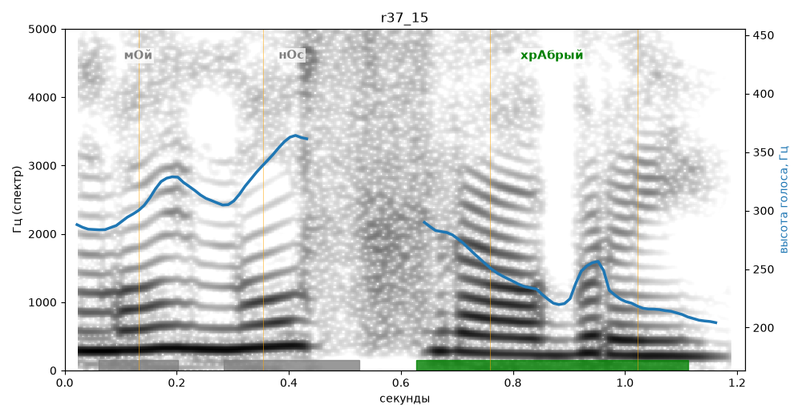

# r37_15

Голос: **Mac Milena** · длительность 1.2 с
Естественность (UTMOS): **2.53 из 5** (живой диктор ≈ 4–4.5)
Эталон: Мой нос храбрый.
Распознано: Мой нос храбрый.
Слова: все совпали

## Ударения
(где нужно: ruaccent)

| слово | нужно | у голоса | |
|---|---|---|---|
| храбрый | хрАбрый | хрАбрый | ✓ |

## Интонация
- ✓ «мой нос храбрый.» — конец фразы понижается — звучит законченно
- Диапазон голоса 9.2 полутонов (живо), средняя высота 279 Гц

## Паузы и темп
- паузы на своих местах
- Темп 3.8 слога/с (медленно)

_Синяя линия — высота голоса. Над словами заглавная буква — где ударение должно быть; красным — голос поставил не туда (уверенно), оранжевым — возможно._
