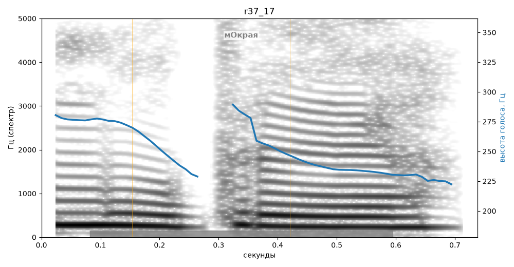

# r37_17

Голос: **Mac Milena** · длительность 0.7 с
Естественность (UTMOS): **2.17 из 5** (живой диктор ≈ 4–4.5)
Эталон: Мокрая!
Распознано: Мукрая.
Расхождения в словах: «мокрая» → «мукрая»

## Ударения
(где нужно: ruaccent)

| слово | нужно | у голоса | |
|---|---|---|---|
| мокрая | мОкрая | — | ? |

## Интонация
- Диапазон голоса 3.8 полутонов (монотонно, как робот), средняя высота 244 Гц

## Паузы и темп
- паузы на своих местах
- Темп 3.9 слога/с (медленно)

_Синяя линия — высота голоса. Над словами заглавная буква — где ударение должно быть; красным — голос поставил не туда (уверенно), оранжевым — возможно._
